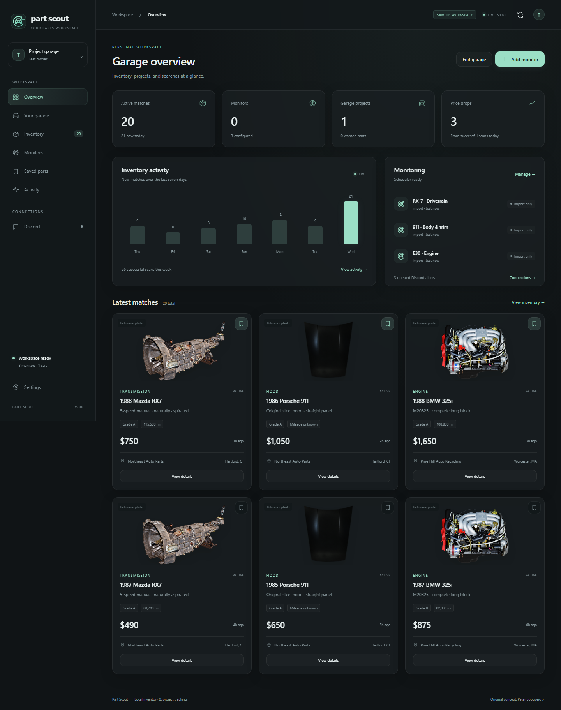

# Part Scout

Your parts searches, project cars, and purchase history in one local workspace.

[**Download the Windows app**](https://github.com/930turbo/part-scout/releases/download/v2.0.0/Part-Scout-2.0.0-Windows-x64.exe) · [Releases](https://github.com/930turbo/part-scout/releases) · [Setup guide](docs/setup.md)



Screenshots use an explicitly labeled sample database. The Windows app and normal server start with a real, empty workspace. Reference photos are labeled; seller photos come from the source listing.

## Start on Windows

1. Download `Part-Scout-2.0.0-Windows-x64.exe` from the release.
2. Run it. No Node.js, Docker, installer, or separate browser download is needed.
3. Open **Your garage**, name the workspace, add your car and photos, and create a parts checklist.
4. Open **Settings** to connect Discord and an inventory source.
5. Create a monitor or use one of the 48 part presets.

Requires Windows 10/11 x64. The executable includes its runtime, browser, database support, and local UI. Internet access is needed for live sources, seller pages, Discord, and optional remote images. Your garage, notes, history, local photos, and exports work offline.

The executable is unsigned. Data is kept in the Windows user profile, separate from the executable. **Settings → Open data folder** shows the location. Closing the window keeps monitoring in the tray by default; **Quit Part Scout** in the tray menu stops the app. This behavior is configurable.

## What you can do

| Workspace         | Capabilities                                                                                                                                                                        |
| ----------------- | ----------------------------------------------------------------------------------------------------------------------------------------------------------------------------------- |
| **Garage**        | Rename the garage, add cars and photos, keep build notes, and track wanted, ordered, bought, or installed parts with budgets, sellers, purchase dates, and amounts paid.            |
| **Inventory**     | Search, filter, sort, bookmark, annotate, compare prices, open seller links, and click through listing photos. Full source records remain available in the details view.            |
| **Monitors**      | Track year ranges and interchange variants; filter by price, mileage, distance, keywords, states, and grades. Link searches to a garage car. Choose from 48 part presets.           |
| **Excel exports** | Export each monitor's eligible listings first discovered within a chosen period. Workbooks include prices, seller links, photo URLs, notes, and price changes in that period.       |
| **Discord**       | Save and test a channel webhook inside Settings. Send new-match or price-drop alerts individually or in batches. Connect a command bot without running a separate terminal process. |
| **Appearance**    | Dark, light, or system mode; mint, violet, blue, amber, or rose accents; configurable animations and refresh interval.                                                              |
| **Activity**      | Watch scans and alert attempts update automatically through a live event stream. Review errors and retry failed deliveries.                                                         |

## Connect Discord

For alerts, a webhook is enough:

1. In Discord, open your channel's **Settings → Integrations → Webhooks**.
2. Create a webhook and copy its URL.
3. Paste it into **Part Scout → Settings → Channel webhook URL**.
4. Click **Send test message**. The app saves the connection and reports whether Discord accepted the message.

To get mention alerts on your phone, enter your Discord user ID and enable **Mention me in Discord alerts**. Enable Discord's **Mobile Push Notifications**, select suitable channel notification settings, and allow OS notifications on your phone. Part Scout controls its mentions; Discord and the phone control whether a notification appears. See [Discord's notification guide](https://support.discord.com/hc/en-us/articles/218892547--Mobile-Notifications-Settings-101).

For `/scout` commands, expand **Discord command bot** in Settings. Enter your bot token, application ID, guild ID, and allowed user IDs. Save connections, use the invite link, then click **Connect & register commands**. Commands include status, monitors, search, scan, pause, and resume. Replies are private and access is limited to the configured guild and users. The optional startup checkbox reconnects it on the next launch.

Named channel destinations remain available through `DISCORD_WEBHOOKS_JSON` for source/server deployments. Alerts survive restarts and retry rate limits; failures remain visible in Activity. Delivery is at least once, so an interrupted acknowledgement can produce a duplicate.

## Inventory sources

### eBay

Uses eBay's official Browse API. Enter production client credentials, or an application access token, in Settings and test the connection. eBay requires a developer account and API access; Part Scout does not include shared credentials.

Searches retain seller links, photos, buying options, condition, shipping data, feedback, and the original API record. **Load full seller gallery** retrieves the item's detailed record and additional images. Keywords are search matches, not verified vehicle fitment.

**Buy from seller** or **View / bid** opens the seller's page in an isolated window inside the Windows app. You sign in, inspect the item, and complete checkout or bidding yourself. The browser edition opens seller links in a separate tab. Part Scout does not place orders, choose bids, or handle payment details.

### Car-Part

Supports saved HTML imports and an authorized polling adapter. Results include stock, vehicle, part, price, mileage, grade, distance, recycler details, links, row photos, and the original cell data. Missing contact or photo fields remain visibly unknown.

Car-Part's [terms](https://www.car-part.com/terms.htm) require permission for automated access. Enable the adapter in Settings after obtaining that permission. It follows recognized numbered result pages up to the monitor's limit. A capped or unrecognized page sequence stays partial, preserving unseen inventory. Direct listing links and images are retained when the page supplies them; no stock-specific link is invented when it does not.

### Authorized feeds and files

Import JSON inventory or a saved results page from a monitor card. [examples/inventory.json](examples/inventory.json) shows the format. HTTPS feeds can return a listing array or `{ "listings": [...], "complete": true }`. Only exact allowed hosts are accepted. Configure hosts you control or trust in Settings.

Three complete successful snapshots missing a listing mark it stale. Partial snapshots and failures never age unseen inventory. First scans establish a quiet baseline unless initial alerts are enabled.

## Run from source

Requires Node.js 24 or newer.

```sh
git clone https://github.com/930turbo/part-scout.git
cd part-scout
npm ci
npm run build
npm start
```

Open [localhost:4310](http://localhost:4310). Connections can be entered in the UI. Optional environment configuration is documented in [.env.example](.env.example). The server binds to loopback by default; network binds require an admin token. For Docker and legacy configuration migration, see [operations](docs/operations.md).

```sh
npm run check
npm test
npx playwright install chromium
npm run test:browser
npm run package:win
```

The last command builds a portable Windows executable into `release/`. The desktop build uses a bundled server; no external modules are needed at runtime. CI checks types, core behavior, browser workflows, and container packaging. A Windows job builds and smoke-tests the desktop executable.

## Documentation

- [Setup and troubleshooting](docs/setup.md)
- [Architecture and behavior](docs/architecture.md)
- [Operations, storage, and migration](docs/operations.md)
- [Photo sources and background edits](docs/imagery.md)
- [Review of the original project](docs/original-review.md)
- [Release history](CHANGELOG.md)

## Credit

Based on [car-part-monitor](https://github.com/dzt/car-part-monitor), created by **Peter Soboyejo (dzt)**. The original idea and Car-Part form/table format are credited in [NOTICE.md](NOTICE.md). Code is MIT licensed; third-party photographic material retains its source owners' rights and is documented separately.
