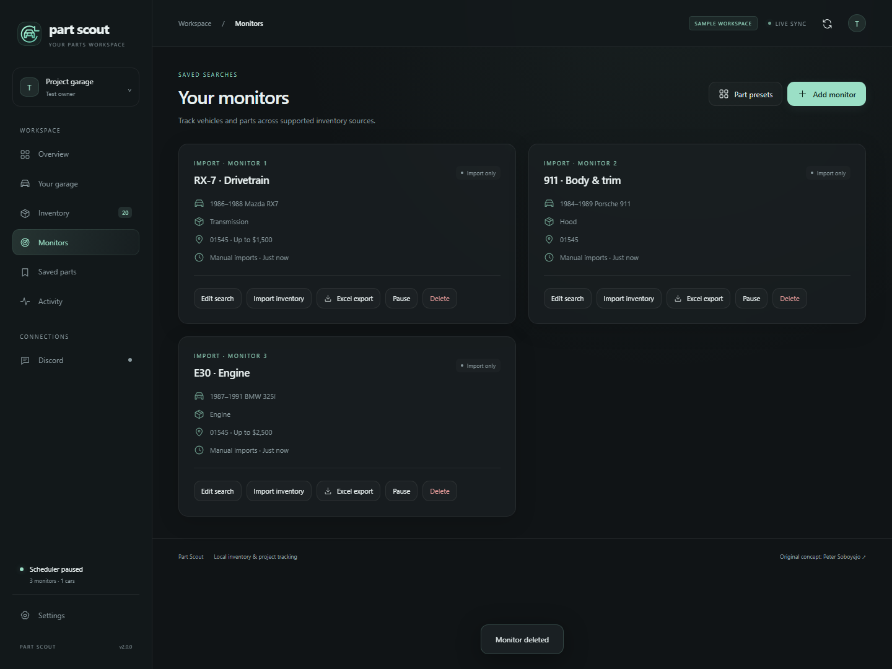
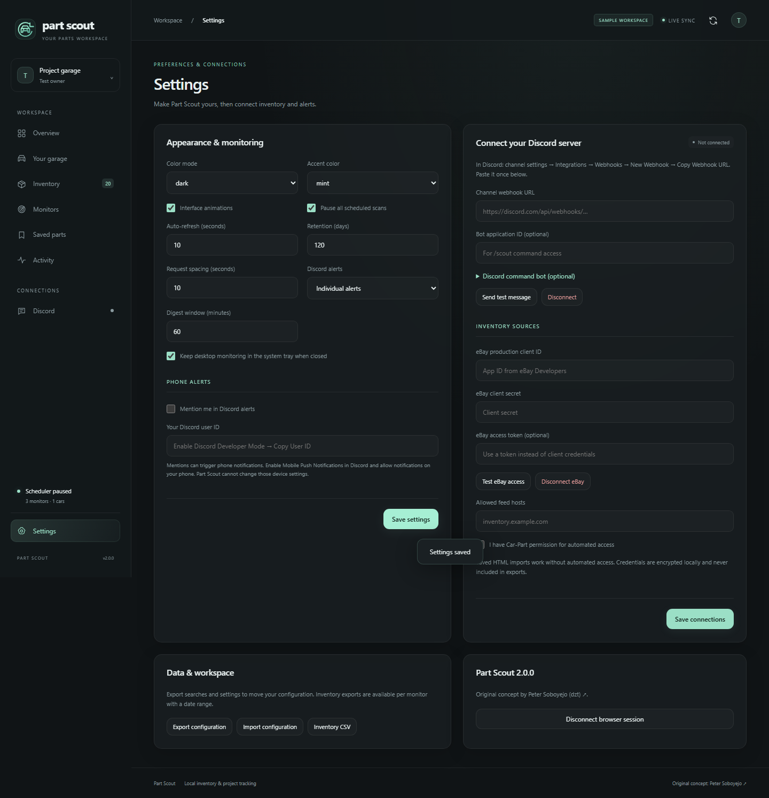

# Part Scout

A self-hosted workspace for used parts inventory. Track searches, compare prices, save a shortlist, and get Discord alerts when a matching part appears or its price drops.


The screenshots show fictional sample inventory. No live stock, prices, or recycler details are implied.

## What it does

- **Inventory dashboard:** responsive cards and tables, search, monitor filters, sorting, pagination, bookmarks, notes, and CSV export.
- **Search profiles:** year ranges, interchange variants, price/mileage/distance caps, required and excluded keywords, states, grades, and explicit handling of unknown values.
- **Price tracking:** stable listing identities, per-monitor observed prices, price history, and price drop alerts. One listing can match several monitors.
- **Reliable monitoring:** one provider request at a time, global request spacing, request deadlines, failure backoff, overlap prevention, and persisted scheduling.
- **Durable Discord alerts:** transactional outbox, retries, rate limit handling, individual messages or batches, visible failures, and manual retry. First scans establish a quiet baseline by default.
- **Discord bot:** `/scout status`, `/scout monitors`, `/scout search`, `/scout scan`, `/scout pause`, and `/scout resume`. Commands are private and restricted to configured users in one guild.
- **Operations:** scan history, health endpoint, configuration import/export, legacy search migration, data retention, Docker setup, and CI.

## Run locally

Requires **Node.js 24 or newer**. SQLite ships with Node; no database service or native module build is needed.

```sh
git clone https://github.com/930turbo/part-scout.git
cd part-scout
npm ci
cp .env.example .env
npm run build
npm start
```

On PowerShell, use `Copy-Item .env.example .env` instead of `cp`. Open [localhost:4310](http://localhost:4310). The server binds to loopback by default. For development, use `npm run dev`.

1. Create a monitor with a vehicle model, part name, year range, and ZIP code.
2. Start with **File import**, or configure an authorized JSON feed.
3. Import `examples/inventory.json` into a 1986–1988 Mazda RX7 Transmission monitor. Check “complete snapshot” only when the file covers the entire search.
4. Set `DISCORD_WEBHOOK_URL` in `.env` and restart to enable alerts. Baseline imports are quiet unless “Alert on the first import or scan” is selected.

To browse the sample workspace without touching your real database:

```sh
npm run demo
```

Then set `DATABASE_PATH=data/demo.db` in `.env` and restart. The demo is visibly labeled, and its notification worker never sends messages. Switch back to `data/part-scout.db` for real use.

## Inventory sources

### JSON feeds and file imports

The example file documents the format. A feed can return a listing array (a complete snapshot) or `{ "listings": [...], "complete": true }`. Without `complete: true`, an object is treated as partial. Stock, year, model, part, and dealer are required. Unknown numeric values use `null`; zero is a valid price or mileage.

For feeds, set `FEED_HOSTS=inventory.example.com` in `.env`, select **HTTPS JSON feed**, and enter the URL. Only exact allowlisted HTTPS hosts are accepted. Redirects, URL credentials, IP literals, private network addresses, and responses larger than 5 MB are rejected. Configure hosts you own or trust; a feed is not a general-purpose URL fetcher.

### Car-Part

The original project's form submission and results parsing are preserved in a separate adapter. Car-Part's [published terms](https://www.car-part.com/terms.htm) describe manual use and restrict automated access. The adapter is disabled by default. Obtain provider permission before setting `CAR_PART_ENABLED=true`.

You can import a manually saved results HTML page without enabling network access. Seven- and eight-column tables are supported; missing dealer locations do not discard an otherwise valid listing. Unrecognized or partially malformed pages fail without changing inventory. Pages advertising more results are treated as partial, so unseen listings are not aged. **The adapter follows numbered provider pages up to the configured limit (five by default, up to twenty). Capped or unrecognized pagination stays partial; it does not promise full market coverage.** Provider format changes require adapter maintenance. Model and part strings must match the provider's identifiers.

## Discord setup

For channel alerts, create a webhook in the channel settings and put its URL in `DISCORD_WEBHOOK_URL`. It is never returned to the browser or included in configuration exports. Set alert mode and digest window in Settings. A failed delivery remains in Activity; correct the configuration, then choose Retry.

For separate channels, set `DISCORD_WEBHOOKS_JSON` to a JSON object of names and webhook URLs (for example, `{"rx7":"https://discord.com/api/webhooks/...","porsche":"https://discord.com/api/webhooks/..."}`). Choose the destination in each monitor's alert preferences. Replace those example URLs with complete valid webhook URLs. Digests only group alerts for the same destination. `DISCORD_WEBHOOK_URL` supplies the default destination.

For commands:

1. Create an application and bot in the [Discord Developer Portal](https://discord.com/developers/applications).
2. Set `DISCORD_BOT_TOKEN`, `DISCORD_APPLICATION_ID`, `DISCORD_GUILD_ID`, and comma-separated `DISCORD_USER_IDS` in `.env`. Every command requires both the configured guild and an allowed user ID.
3. Invite the bot with the `bot` and `applications.commands` scopes. No privileged gateway intents are needed.
4. Run `npm run bot:register`, then run `npm run bot` beside the server.

The bot calls the same HTTP API as the dashboard. It acknowledges commands before doing longer work. Set `SCOUT_API_URL` and the matching `ADMIN_TOKEN` for a separate server. Remote connections require HTTPS. Webhook alerts and bot commands are independent; neither requires the other.

## Docker

Set `ADMIN_TOKEN` to a random value of at least 24 characters in `.env`, then:

```sh
docker compose up --build -d
# Also run the optional command bot:
docker compose --profile discord up --build -d
```

The dashboard port is published on loopback. Enter the token when the browser connects. The database lives in the `scout-data` volume. To register Discord commands from the image:

```sh
docker compose run --rm -e DISCORD_APPLICATION_ID -e DISCORD_BOT_TOKEN -e DISCORD_GUILD_ID scout node dist/register.js
```

Export those variables in your shell for that command, or use `npm run bot:register` locally. For a remote dashboard, use an HTTPS reverse proxy and retain authentication. Run exactly one server process per database; the command bot uses its API rather than opening SQLite.

## Migrate from car-part-monitor

```sh
npm run migrate -- /path/to/original-project
```

Reads the original `monitors.json` and `config.json`, converts each vehicle/part search into a monitor, and leaves imports paused for review. Common hourly, stepped-minute, stepped-hour, and daily schedules become fixed intervals; intervals below 15 minutes are raised to 15. Complex cron schedules are rejected before any write. A fixed interval is not an exact cron wall-clock schedule. Re-running skips existing search names. Existing webhook secrets and the original inventory database are not copied. Export old inventory and use the JSON format if you need historical stock in the new workspace.

## Verify

```sh
npm run check
npm test
npm run build
npx playwright install chromium
npm run test:browser
npm run benchmark
```

Core tests cover transaction rollback, multi-monitor price changes, deduplication, filtering, partial snapshots, stale inventory, durable alerts, Discord rate limits, scan serialization, authentication, import validation, and CSV escaping. Browser tests cover desktop/mobile layouts, search, notes, bookmarks, monitor creation/import/edit/delete, settings, and screenshots. See [architecture](docs/architecture.md) and [operations](docs/operations.md) for behavior and limits.

<details>
<summary>More screenshots</summary>




</details>

## Credit

Based on the idea behind [car-part-monitor](https://github.com/dzt/car-part-monitor), created by **Peter Soboyejo (dzt)**. See [NOTICE.md](NOTICE.md) for attribution and [LICENSE](LICENSE) for the MIT license.
