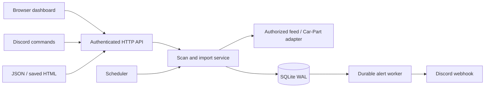

# Architecture

The server, scheduler, notification worker, and optional Discord gateway run in one process. The Windows app bundles that process and its browser with Electron. The browser edition uses the same small native JavaScript application. A bot user authorized in the configured guild controls the same single-tenant workspace as its administrator.

## Storage and identity

`monitors` stores validated search configuration and persisted schedule state. `listings` stores the current listing, first/last observation, bookmark, and note. `matches` links each listing to each monitor with eligibility, its last observed price, and a missed-snapshot count. `prices` stores price changes; `runs` and `jobs` record operational history. Foreign keys and cascading deletes keep associations consistent. Settings live in `meta`.

A provider-wide source ID, when available, defines a listing's SHA-256 identity. Otherwise identity covers normalized recycler name, city, state, stock number, vehicle year/model, and part type. Prices and descriptions do not affect identity. A recycler changing its name or location produces a new identity when the source has no stable ID.

Each import/scan runs in one transaction: upsert listings, record price changes, update monitor associations, enqueue unique alerts, and persist scan state. A failure rolls everything back. Prepared statements are cached; indexed matches, jobs, dates, and price history support bounded reads. The UI paginates at 30 records. Inventory export collects all matching records and is intended for personal-scale workspaces.

## Scheduling and lifecycle

Only one scan runs at once. Provider requests share a global spacing budget rather than a delay per vehicle. Every network request has a deadline; response bodies are bounded. A failure records its reason and schedules a retry with exponential backoff capped at one day. Disabled and file-import monitors do not run on the clock. Editing a monitor makes its next scheduled check due; it does not replace an in-flight scan.

Three complete successful snapshots missing a listing mark that monitor's association stale. Partial snapshots and failures never age unseen listings. A part remains active when at least one association still sees it. The UI's Active only filter hides stale associations. Stale does not prove a part was sold; it records absence from your successful snapshots.

Filters are applied to observed listings, so a previously over-budget part can become eligible after a price drop. Editing filters recalculates eligibility but does not emit alerts retroactively. Price changes are recorded globally and compared separately per monitor when deciding alerts.

## Alert delivery

The first observation establishes a baseline unless `notifyInitial` is enabled. New matches and price drops become outbox jobs only when their alert preference is enabled. Off mode does not create new jobs and pauses delivery of existing jobs. Digest mode delays new jobs by the configured window and delivers due jobs in batches of up to ten embeds; it is a rolling window, not a daily wall-clock digest.

Jobs move from pending to sending to sent. Network failures and rate limits return them to pending with a future due time. Other HTTP 4xx responses fail permanently. Eight failed attempts also mark a job failed. The UI can requeue failed jobs. Restart recovers interrupted sending jobs. Delivery is **at least once**: if Discord accepts a message and the process exits before the success is recorded, it may be sent again. Discord webhooks provide no idempotency key to eliminate that window.

## Security boundaries

Loopback is the default. A network bind requires a sufficiently long admin token. The desktop app uses a random token and an ephemeral local port; only its trusted UI session receives that token. Seller windows have no Node access, no app preload, and a separate browser session. UI credentials use Windows safe storage when available; the server fallback uses AES-GCM and a local private key file. Secrets never appear in public API metadata or configuration exports.

Origin checks reject cross-site API calls, CSP restricts script execution, listing text is escaped, and CSV exports neutralize formula prefixes. Discord mentions are disabled except for the one explicitly configured phone-alert user. Feed URLs are administrator data: avoid secrets in query strings because configuration exports include those URLs.

Feeds require exact configured hosts and public DNS addresses; redirects and credential-bearing URLs are rejected. Hostnames must be trusted and under stable administration. DNS validation is not a substitute for an outbound firewall in hostile environments. The Car-Part target and Discord webhook host are fixed. Bot access is restricted to the configured guild and explicit user IDs; replies are ephemeral.

## Deliberate limits

- One server process and one SQLite file. No distributed workers or cluster deployment.
- No accounts, billing, team roles, or multi-guild tenant separation.
- Provider results are not independently verified; fitment and availability still require recycler confirmation.
- The Car-Part adapter follows recognized numbered pages up to the monitor limit. Capped or unrecognized pagination stays partial. Tests use synthetic fixtures, not a live permission-backed end-to-end run.
- Discord commands and API-backed listings require your account credentials. Fixture checks do not replace a live connection test.
- Health reports process readiness. Provider failures and alert delivery failures are visible in Activity, not hidden by a green health endpoint.
